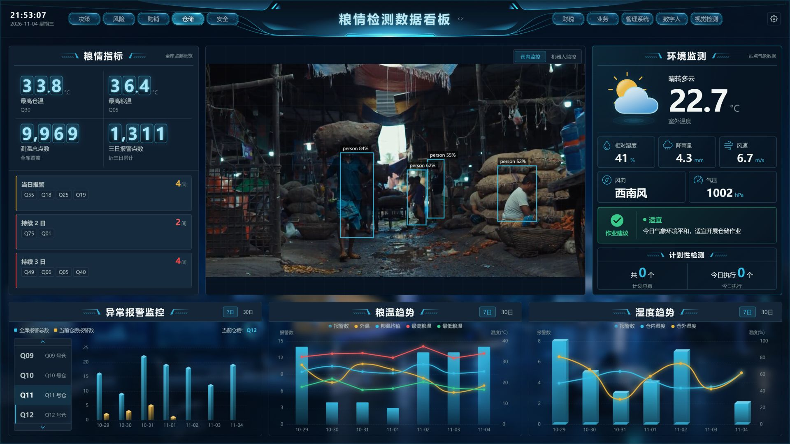
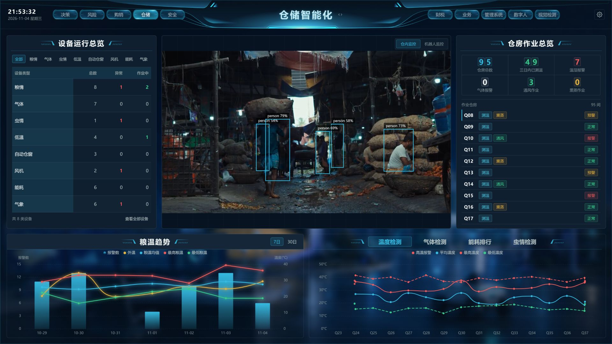
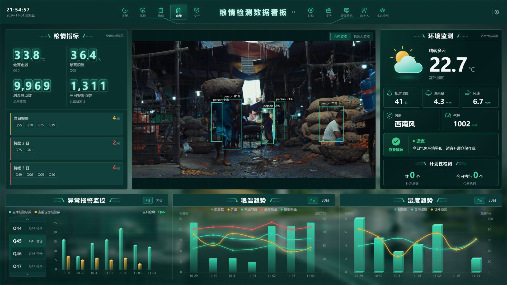
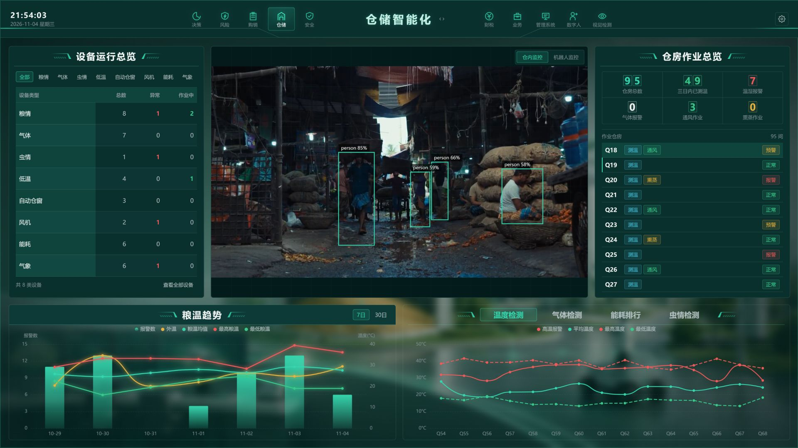

<p align="center">
  
</p>

# GranaryScope

[简体中文](README.md) | **English**

**GranaryScope · Smart Grain Storage Dashboard**  
See storage through data. Connect with the site through vision.

GranaryScope is a grain storage visualization dashboard built with Vue 3, TypeScript, and ECharts. It combines FastAPI, MediaMTX, and YOLO video detection to explore interfaces for smart grain storage, industrial visualization, and digital-twin scenarios.

Explore the code to learn about dashboard layouts, charts, theme switching, and video detection. Ideas and feedback are welcome via Issues.

> **Project status: a demonstration and development reference, not a complete production system.** Most business data—including grain temperature, humidity, equipment, and alerts—is mocked. Connecting real operations requires your own APIs, database, sensors, or other hardware. Video detection requires separately deployed media services, model weights, and a video source. This project does not provide a real 3D digital-twin model of a granary.

## Screenshots

| Blue · Grain monitoring | Blue · Smart storage |
| :---: | :---: |
|  |  |
| **Green · Grain monitoring** | **Green · Smart storage** |
|  |  |

> The screenshots use [market footage by Shanto Debnath on Pexels](https://www.pexels.com/video/busy-market-scene-with-workers-and-sacks-34433543/) for demonstration; it is not footage of the project's actual grain facility. Detection boxes come from local YOLO inference. Charts and business metrics use mock data.

## Features

- **Two themes, two views:** blue and green themes for grain monitoring and smart storage.
- **Storage data visualization:** grain-condition indicators, alerts, temperature and humidity trends, equipment, and warehouse operations.
- **Video and object detection:** MediaMTX supplies WebRTC/WHEP video; the backend sends YOLO results over WebSocket for a Canvas overlay.
- **Large-screen layout:** designed for 1920 × 1080, with Vue components, Pinia state management, and separate API and mock layers.

## Tech stack

| Layer | Technologies |
| --- | --- |
| Frontend | Vue 3, TypeScript, Vite, Pinia, Vue Router, ECharts, SCSS, Mock.js |
| Video detection | Python 3.11, FastAPI, Ultralytics YOLO, PyAV, WebSocket |
| Media server | MediaMTX, RTSP, WebRTC/WHEP |

```text
Video source → MediaMTX ──WHEP/WebRTC──→ Browser video
                  └──RTSP──→ YOLO backend ──WebSocket──→ Canvas detection overlay
Mock data / your business APIs ─────────────────────────→ Dashboard charts
```

## Quick start: frontend

Requires Node.js 20.19+ or 22.12+. From the repository root:

```bash
cd FRONT
npm ci
npm run dev
```

Visit [http://localhost:2355](http://localhost:2355). The frontend alone lets you explore both themes with mock data. The monitoring area shows connection status until the video pipeline is running.

## Connect video and YOLO

The following is a basic Windows development workflow. Configure and verify your own camera and network environment.

1. Create an isolated Python 3.11 environment and install the backend dependencies from the repository root:

   ```powershell
   conda create -n liangcang-yolo python=3.11 -y
   conda activate liangcang-yolo
   pip install -r backend/requirements.txt
   Copy-Item backend/.env.example backend/.env
   ```

2. Download MediaMTX v1.20.1 for Windows from its [official releases](https://github.com/bluenviron/mediamtx/releases/tag/v1.20.1) and place the runtime in `infra/mediamtx/dist/v1.20.1/runtime/`. Obtain `backend/models/yolo11n.pt` separately, subject to the model's terms of use. This repository does not include model weights or the MediaMTX binary.
3. Copy `infra/mediamtx/.env.example` to `infra/mediamtx/.env` and configure your camera's RTSP URL. Do not commit credentials or put them in frontend code. Alternatively, start the script in `-Inert` mode and use FFmpeg to publish your own local video to `rtsp://127.0.0.1:8554/camera1`. In that mode, include the frontend origin in `MTX_WEBRTCALLOWORIGINS`.
4. Start MediaMTX from the repository root:

   ```powershell
   powershell -ExecutionPolicy Bypass -File infra/mediamtx/Start-MediaMTX.ps1
   ```

5. Start the backend in another terminal, then start the frontend:

   ```powershell
   cd backend
   python -m uvicorn liangcang_backend.main:app --app-dir src --host 127.0.0.1 --port 8000
   ```

`backend/.env.example` enables inference by default and points to local MediaMTX; set `INFERENCE_DEVICE` to match your hardware. The frontend defaults to ports 8889 (WHEP) and 8000 (detection WebSocket) on the current host. Check media addresses, CORS, networking, and firewall settings for your deployment. Robot monitoring and external management links use local placeholder addresses and need your own configuration or adaptation.

## Repository structure

```text
FRONT/                 Vue dashboard, API layer, and mock data
backend/               FastAPI, video inference, tests, and tools
infra/mediamtx/        Media server configuration and startup script
docs/screenshots/      Project screenshots
```

## Scope and limitations

- This project is intended for demonstration and learning. Permissions, security, alert reliability, and operations require further work for production use.
- Mock business data does not represent actual storage conditions. Validate your own API and hardware integrations.
- The public repository does not include the original site configuration, weights, external systems, or hardware. Detection classes and results depend on your model, video, and settings.
- Review the licenses for third-party assets, Ultralytics models, and dependencies before use or distribution. Project code is licensed under [MIT](LICENSE); third-party licenses remain unchanged.

## Community

Issues about dashboard design, data integration, and video detection are welcome. If GranaryScope helps you, consider starring the repository so others can find it.
