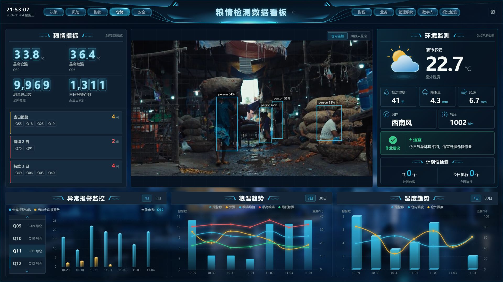
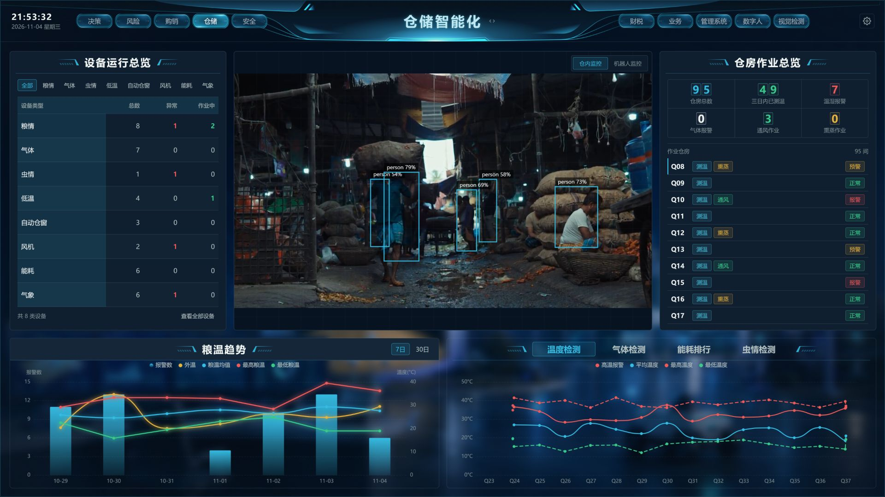
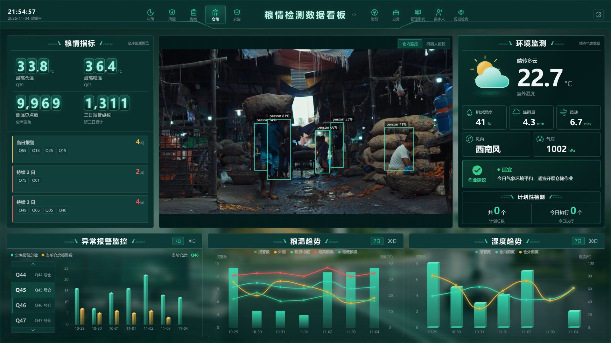
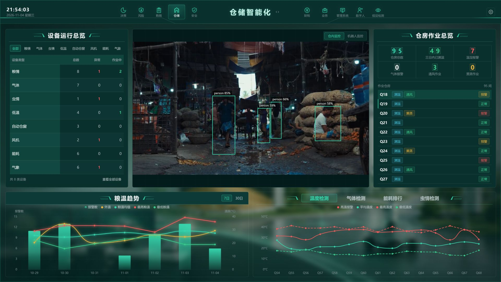

<p align="center">
  
</p>

# GranaryScope · 谷仓视界

**简体中文** | [English](README.en.md)

**谷仓视界 · 智慧粮仓可视化大屏**  
用数据看见仓储，用视觉连接现场。

基于 Vue 3、TypeScript 与 ECharts 的粮仓数据可视化大屏，结合 FastAPI、MediaMTX 和 YOLO 视频检测，探索智慧仓储、工业可视化与数字孪生场景的交互展示。

欢迎用于学习数据大屏布局、图表设计、双主题切换和视频检测链路，也欢迎通过 Issue 分享想法。

> **项目状态：展示与开发参考版本，非完整生产系统。** 粮温、湿度、设备、报警等多数业务数据为 Mock；接入真实业务需自行对接 API、数据库、传感器或其他硬件。视频检测依赖单独部署的媒体服务、模型和视频源。项目不提供真实粮仓数字孪生三维模型。

## 项目预览

| 蓝色 · 粮情检测看板 | 蓝色 · 仓储智能化 |
| :---: | :---: |
|  |  |
| **绿色 · 粮情检测看板** | **绿色 · 仓储智能化** |
|  |  |

> 截图内视频为 [Pexels：Shanto Debnath 的市场搬运素材](https://www.pexels.com/video/busy-market-scene-with-workers-and-sacks-34433543/)，用于演示，非项目真实粮仓现场；框为本地 YOLO 推理结果。图表与业务指标为模拟数据。

## 你可以探索什么

- **两套主题、两个页面**：蓝色与绿色主题，覆盖粮情检测看板和仓储智能化。
- **仓储数据可视化**：粮情指标、报警、温湿度趋势、设备与仓房作业概览。
- **视频 + 目标检测**：MediaMTX 提供 WebRTC/WHEP 播放，后端 YOLO 推理结果经 WebSocket 发送，由前端 Canvas 叠加。
- **大屏适配**：以 1920 × 1080 为设计基准；采用 Vue 组件、Pinia 状态管理和 API/Mock 分层。

## 技术栈

| 层次 | 技术 |
| --- | --- |
| 前端 | Vue 3、TypeScript、Vite、Pinia、Vue Router、ECharts、SCSS、Mock.js |
| 视频检测 | Python 3.11、FastAPI、Ultralytics YOLO、PyAV、WebSocket |
| 媒体服务 | MediaMTX、RTSP、WebRTC/WHEP |

```text
视频源 → MediaMTX ──WHEP/WebRTC──→ 浏览器视频
             └──RTSP──→ YOLO 后端 ──WebSocket──→ Canvas 检测框
Mock / 自行接入的业务 API ─────────────────────→ 大屏图表
```

## 快速体验前端

需要 Node.js 20.19+ 或 22.12+。在项目根目录执行：

```bash
cd FRONT
npm ci
npm run dev
```

访问 [http://localhost:2355](http://localhost:2355)。仅启动前端即可浏览模拟数据和两套主题；没有启动视频链路时，监控区域会显示连接状态。

## 接入视频和 YOLO

以下为 Windows 本地开发的基本流程；真实摄像头和网络环境需自行配置并验证。

1. 准备 Python 3.11 的独立环境，在项目根目录安装后端依赖：

   ```powershell
   conda create -n liangcang-yolo python=3.11 -y
   conda activate liangcang-yolo
   pip install -r backend/requirements.txt
   Copy-Item backend/.env.example backend/.env
   ```

2. 按 [MediaMTX 官方发布页](https://github.com/bluenviron/mediamtx/releases/tag/v1.20.1)准备 Windows 版 v1.20.1，放置于 `infra/mediamtx/dist/v1.20.1/runtime/`。根据模型使用条款自行准备 `backend/models/yolo11n.pt`。本仓库不包含模型权重或 MediaMTX 二进制文件。
3. 配置 `infra/mediamtx/.env`：从同目录 `.env.example` 复制，填写自己的摄像头 RTSP 地址。不要提交密码或将 RTSP 凭据写入前端。也可使用脚本的 `-Inert` 模式并用 FFmpeg 推送自己的本地视频到 `rtsp://127.0.0.1:8554/camera1`；此模式下应通过环境变量 `MTX_WEBRTCALLOWORIGINS` 将前端来源加入白名单。
4. 从项目根目录启动 MediaMTX：

   ```powershell
   powershell -ExecutionPolicy Bypass -File infra/mediamtx/Start-MediaMTX.ps1
   ```

5. 在另一终端启动后端，再启动前端：

   ```powershell
   cd backend
   python -m uvicorn liangcang_backend.main:app --app-dir src --host 127.0.0.1 --port 8000
   ```

`backend/.env.example` 默认启用推理并指向本机 MediaMTX；按硬件情况设置 `INFERENCE_DEVICE`。前端默认连接当前主机的 8889（WHEP）和 8000（检测 WebSocket）端口。部署时需核对媒体服务地址、跨域、网络与防火墙设置。机器人监控和外部管理入口使用本机占位地址，需自行配置或改造。

## 目录

```text
FRONT/                 Vue 大屏、API 与模拟数据
backend/               FastAPI、视频推理、测试与工具
infra/mediamtx/        媒体服务配置与启动脚本
docs/screenshots/      项目截图
```

## 当前边界

- 本项目供展示和学习；权限、安全、告警可靠性和生产运维需要根据实际场景完善。
- 模拟业务数据不代表真实仓储状态；替换为自己的 API 与设备数据后需自行验证。
- 公开版没有携带原现场配置、权重、外部系统及硬件。检测类别和效果取决于所用模型、视频内容与配置。
- 使用或分发第三方素材、Ultralytics 模型及依赖前，请分别核对其许可证。项目代码采用 MIT 许可证，详见 [LICENSE](LICENSE)；第三方素材、模型和依赖不因该许可证而改变其原有许可。

## 交流与支持

欢迎提交 Issue 讨论大屏设计、数据接入和视频检测；如果这个项目对你有帮助，欢迎点一个 Star，帮助更多开发者发现它。
